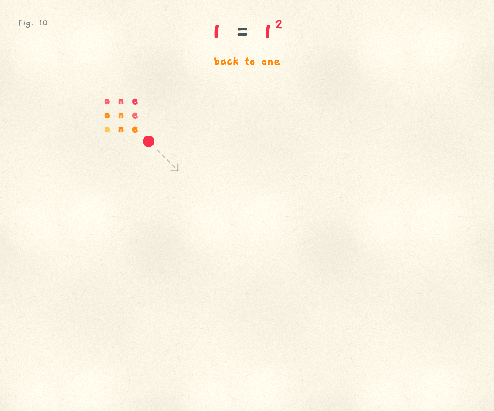

# The Odd Squares

Fig. 10 in my "math facts that live in my head" series. Add up the odd numbers in order and you always land on a square: 1 + 3 + 5 + 7 = 4².

A square of hand-lettered letters grows from one corner. Each L-shaped layer spells its own odd number, down its arm and along its foot: one, three, five, seven, up to thirteen. Every time a new L snaps around the corner, the letters make a square again, and the top line counts it up. At seven layers it peels back to one.

Open it: https://ibeez.github.io/odd-squares/



[Watch one loop (MP4)](exports/odd-squares-loop.mp4): 16 seconds with sound, H.264 + AAC, 1200 × 1000 at 30 fps.

## Run It Locally

```bash
python3 -m http.server 8792 --bind 127.0.0.1
```

Then open http://127.0.0.1:8792/.

Drag the red knob at the corner out or in, or use the arrow keys. Touch it once to start the music. The `sound` button mutes it. Reduced motion turns off the demo and the breathing ink and shows four layers.

Re-render the video from the series' `design/` folder with `python3 tools/export.py ../odd-squares/index.html`. Headless Chrome steps `index.html?render` one frame at a time and the page renders its audio offline.

## How It Works

One canvas, plain JavaScript, no libraries. Each unit of the square is 3 by 3 letters, so layer k is an L of 2k - 1 units. The knob is a heavy spring that trails your hand and clunks into the layer where you let go; each layer springs in from beyond the corner with a little overshoot. The letters only breathe their ink, since a figure this dense shakes if every letter wobbles.

All sound is synthesized with Web Audio: a toy piano in E flat at 90 BPM, six bars that loop with the 16 second figure, a wooden block clack that climbs a step for each layer, a soft chime chord as the square closes, and a falling note for each layer peeled off. Notes for other pieces: [`../chiptune-music.md`](../chiptune-music.md).
